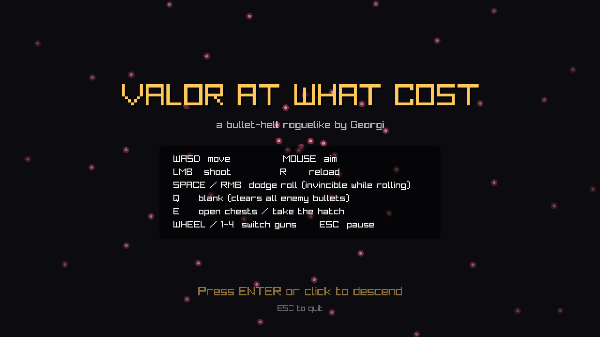
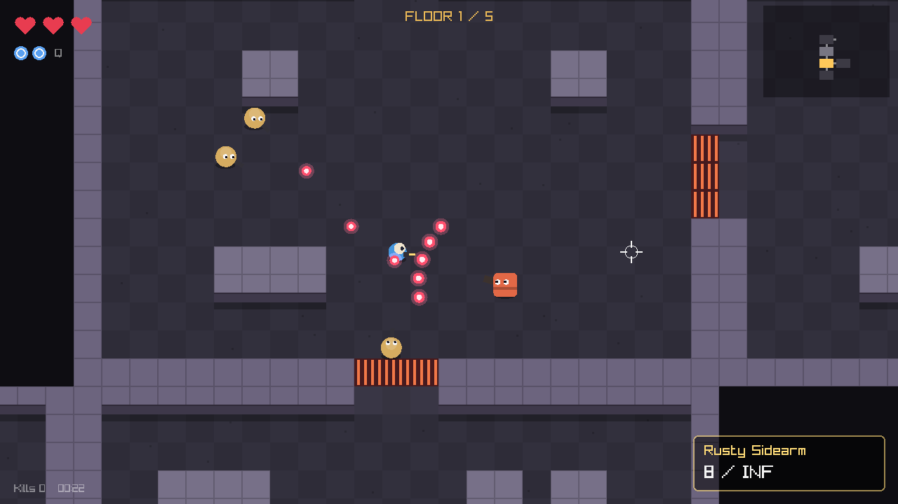
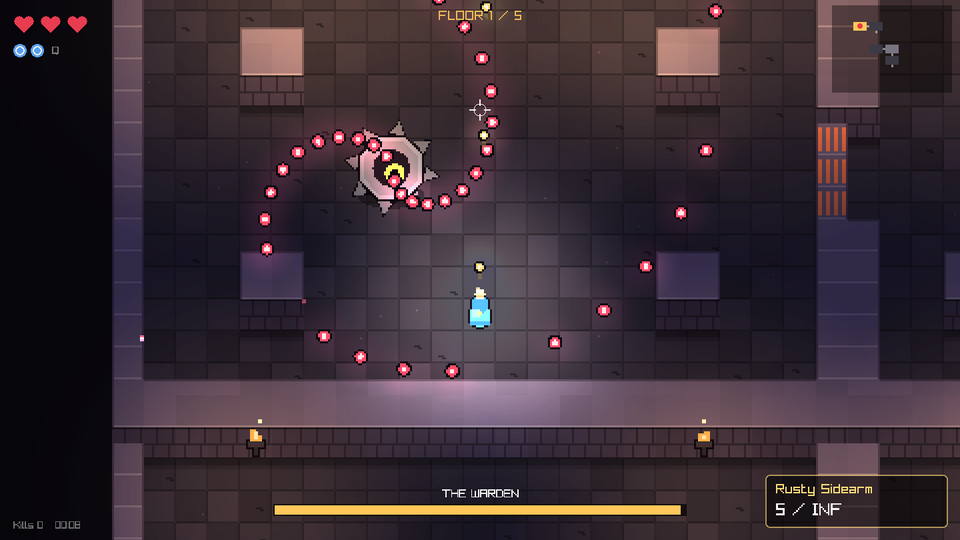
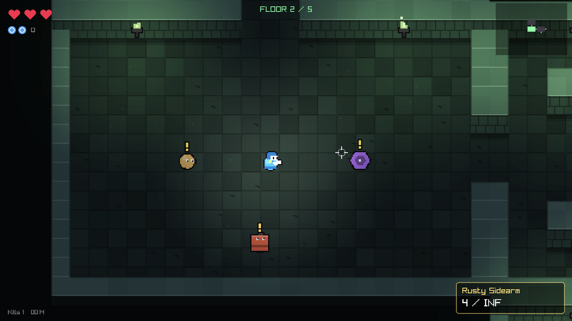

<div align="center">

# Valor at What Cost

**A top-down bullet-hell roguelike, written from scratch in C++.**

*Created by **Georgi D. Georgiev** ([@gigaflippy](https://github.com/gigaflippy))*



</div>

## About the game

Five floors down. Every room locks behind you. Every enemy fills the air with bullets.

You are a lone gunner descending through a dungeon that rebuilds itself every run. Roll through bullet patterns, use your rare blanks to wipe the screen clean, loot new guns from hidden chests, and face **the Warden**, a spiked sentinel guarding the hatch at the bottom of each floor. Reach the bottom of floor five and you escape. Die, and you start again from the top.

**Highlights**

- **Every run is different.** Each floor is generated fresh: a branching layout of rooms with the boss at the deepest dead end.
- **Readable bullet-hell combat.** Enemies flash a warning before they fire, and your hitbox is smaller than your sprite. You dodge with skill, not luck.
- **A boss with two phases.** The Warden fires rings, spirals and aimed fans, then turns red below half health and starts lobbing mortars that burst into rings.
- **Four guns:** a trusty sidearm with infinite ammo, a shotgun, a rivet SMG, and a piercing railgun.
- **Five themed floors**, from the Breach Halls down to the Gunmetal Abyss, each harder than the last.
- **Pixel-art presentation.** The world is drawn on a 480×270 canvas and scaled up with crisp pixels, with three-quarter-view walls, outlined characters and dynamic lighting.
- **Braziers and embers.** Every floor burns in its own colour: wall braziers light the rooms and shed embers into the dark.
- **No asset files at all.** Every shape is drawn and every sound is synthesised in code at startup.

| Combat | The Warden | Floor 2 |
|---|---|---|
|  |  |  |

**Tech:** C++17 · raylib 5.5 · CMake · ~1,550 lines, single source file

## Build

You need a C++17 compiler, CMake 3.16+ and git. raylib 5.5 is downloaded and built automatically on first configure.

**Linux (Debian/Ubuntu)**: install the X11/OpenGL headers once:

```bash
sudo apt install build-essential cmake git libx11-dev libxrandr-dev libxinerama-dev libxcursor-dev libxi-dev libgl1-mesa-dev
```

Then, on any platform:

```bash
cmake -S . -B build
cmake --build build -j
./build/valor          # Windows: build\Release\valor.exe
```

**Platforms:** Linux and Windows. Every push is built on both by GitHub Actions; each run's **Artifacts** section has a ready-to-play folder for each platform. Windows release builds bundle their runtime, so they run on any Windows 10/11 PC without installing anything.

## Controls

| Input | Action |
|---|---|
| WASD / arrows | Move |
| Mouse | Aim |
| Left mouse | Shoot (hold for automatic guns) |
| Space / right mouse | Dodge roll: invincible for most of the roll |
| Q | Blank: wipes every enemy bullet on screen (2 per floor, more from drops) |
| R | Reload |
| E | Open chest / descend through the hatch |
| Wheel / 1-4 | Switch guns |
| Esc / P | Pause |

## How a run works

- Each floor is a procedurally grown tree of rooms. The boss is always at the deepest dead end; a chest room holds a new gun.
- Entering a combat room locks the doors until every wave is dead. Clearing a room can drop a heart, ammo or a blank.
- Enemies flash a yellow **!** just before they fire.
- Your hitbox is smaller than your sprite, as in most bullet-hells.
- After the Warden falls, step on the hatch and press E. Each floor is harder (more rooms, more HP, faster fire) and has its own palette.

**Enemies:** Grunt (aimed single shots, strafes), Scatter (5-bullet fans), Whirl (spinning 4-arm bursts, from floor 2), and the Warden: rings, spirals, aimed fans, and splitting mortars once enraged below 50% HP.

**Guns:** Rusty Sidearm (infinite), Scattergun, Riveter (SMG), Railspike (piercing).

## Debug mode

`./build/valor --debug` enables:

- **F1**: god mode
- **F2**: kill everything in the room
- **F3**: teleport to the boss room
- **F4**: spawn one of every regular enemy around you
- **F5**: reload everything in `data/` while playing

## Modding and balancing: `data/`

All game content lives in plain JSON files, so balancing or adding content needs no recompiling:

| File | What it holds |
|---|---|
| `data/guns.json` | Every gun: damage, fire rate, magazine, spread, bullet speed, colour, sound |
| `data/enemies.json` | Every enemy: behaviour (`shooter`, `spinner`, `warden`), shape, stats, attacks, spawn chances |
| `data/floors.json` | Floor names and colour palettes; the number of entries is the number of floors |
| `data/rules.json` | Player stats, difficulty scaling, wave sizes, drop chances |

Each file starts with a `_comment` explaining its fields. Run with `--debug`, edit a file, press **F5** and the change applies instantly. A typo shows an error naming the exact file and field. Set the `VALOR_DATA` environment variable to load a different data folder.

## Code tour

| Path | What's there |
|---|---|
| `src/main.cpp` | Window, audio device and the main loop |
| `src/core/` | Global constants (`config.hpp`), random numbers, math and text helpers |
| `src/world/dungeon.*` | Floor generation (room tree, boss/chest placement, pillars) and tile collision |
| `src/audio/sfx.*` | Procedural sound synthesis and polyphonic playback |
| `src/game/content.*` | Loads and validates `data/*.json` into typed definitions |
| `src/game/entities.hpp` | Plain data for the player, enemies, bullets, pickups, particles |
| `src/game/game.hpp` | The `Game` class that owns a run's state |
| `src/game/game.cpp` | Run lifecycle, the per-frame update, debug keys |
| `src/game/player.cpp` | Movement, dodge roll, shooting, reloading, blanks, chests |
| `src/game/rooms.cpp` | Door locking, wave spawning, room rewards |
| `src/game/enemies.cpp` | Enemy AI, the Warden's bullet patterns, damage |
| `src/game/combat.cpp` | Bullets, pickups and particles each frame |
| `src/game/render.cpp` | Pixel canvas, three-quarter walls, depth sorting, outlines, lighting |
| `src/game/hud.cpp` | HUD, minimap, menus |

## Ideas for next steps

- Shop rooms and a currency drop
- Active items and passive upgrades
- Sprite sheets instead of primitive shapes
- Gamepad support (raylib has it built in)

## Author

Designed and developed by **Georgi D. Georgiev** ([@gigaflippy](https://github.com/gigaflippy)).

© 2026 Georgi D. Georgiev. All rights reserved. See [LICENSE](LICENSE).
